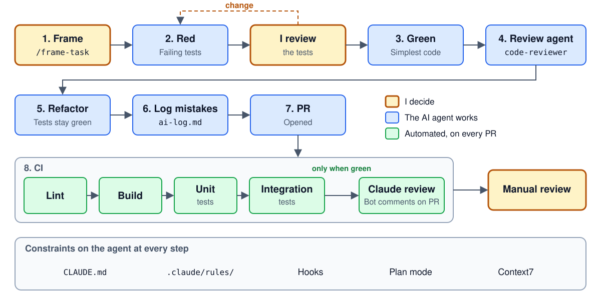

# Unified Document Viewer

A backend that lists every document for a VIN from the Sales and Service systems. Design: [`docs/system-design-document.md`](docs/system-design-document.md).

## Build
Needs JDK 21 and Docker.
```bash
./mvnw package -DskipTests
```

## Run
Start the containers, then the app on port 8080:
```bash
docker compose up -d --wait
./mvnw spring-boot:run
curl -H 'X-User-Id: user-1' -H 'X-Dealership-Id: dealer-1' \
  http://localhost:8080/api/v1/vehicles/WVWZZZ1JZXW000001/documents
```
- Swagger UI: http://localhost:8080/swagger-ui.html
- Grafana: http://localhost:3000/d/document-viewer
- Jaeger: http://localhost:16686
- Prometheus: http://localhost:9090

Stop with `docker compose down -v`.

## Test
```bash
./mvnw test     # unit tests
./mvnw verify   # unit + integration tests (needs Docker)
```
Core business logic tests (`src/test/java`):

| Test | Checks |
|---|---|
| `VinTest` | VIN validation and masking |
| `ResultMergerTest` | Merging both sources into one list |
| `DocumentSearchServiceTest` | Parallel calls, deadline, audit, fallback, circuit breaker |
| `SnapshotFallbackTest` | Fallback copies, at most 24 h old |
| `RetryOnTransientErrorTest` | Retry only on transient errors |

## AI Collaboration Narrative


**Strategy.** I wrote the design and the task list first. Claude Code then worked one task at a time: `/frame-task` agrees the tests with me, and `/implement-task` makes them pass.

**Verification and refinement.** Tests are committed before any code, and the AI may not weaken them. Every change passes four checks: tests, a `code-reviewer` agent, a Claude PR review in CI, and my own review.

**Final quality.** Each check caught something the others missed:
- Tests: a `@Retryable` that Spring ignored
- Reviewer agent: a slow search overwriting a newer fallback copy
- Claude PR review: the full VIN leaking into a trace
- My review: Grafana showing 0 for an open circuit breaker
