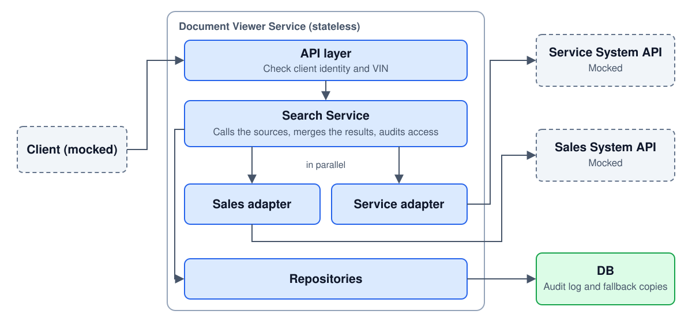
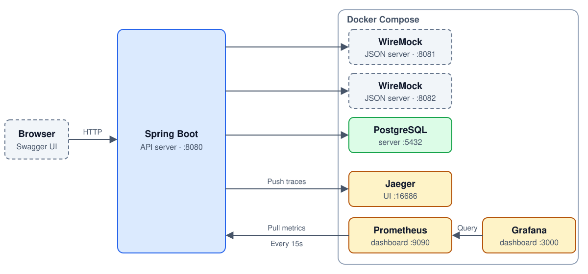
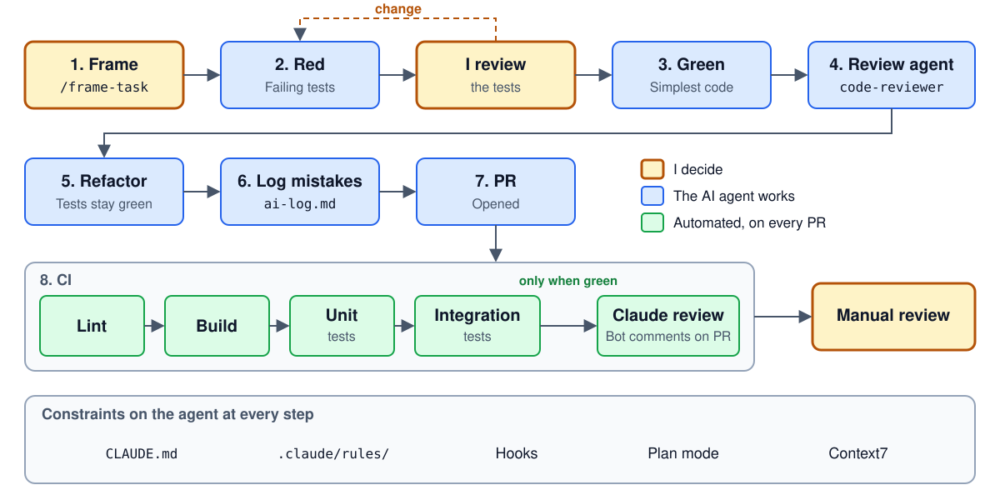

# Unified Document Viewer

About me: **Hien Giang**, Backend Developer

I choose: Scenario D - Backend

<!--
Before recording: put the next two lines in your own words, and recheck the mistake count on slide 9.

Hi, I'm Hien Giang, a backend developer. [Add one sentence about your background.] I chose Scenario D, the Unified Document Viewer, because I've worked on production platforms that demand resilient design, and this scenario is really about what happens when systems you don't control fail. I built the backend. I'll cover the design, how I worked with AI, and a demo.
-->

---

# The problem
Users want to get a list of documents related to their VIN (Vehicle Identification Number)
- The backend must call external systems **in parallel**


<!--
A dealership user enters a VIN and sees every document for that vehicle in one list, with the source on each one. The documents live in two systems that return different shapes, and the backend calls them in parallel. My targets are most searches under a second, no wait over about 2.5 seconds, and 99.9 percent success.
-->

---

<!-- _class: compact -->

# Core assumptions


| Assumption                                         | Consequences                                                                                                                                        |
|----------------------------------------------------|-----------------------------------------------------------------------------------------------------------------------------------------------------|
| **We can serve stale docs, but only up to 24 hours** | Need a persistence engine to store fresh documents in successful calls<br/>A mechanism to clear stale docs<br/>Document must have state (NEW, STALE) |
| VINs can be personal data (linked to a person)     | Require client identity and every access is audited. VINs are also masked everywhere                                                                |
| The external APIs return different shapes          | Cannot express all schemas, only send document URLs back to client                                                                                  |


---

# System Architecture



<!--
The service is stateless, so it scales by adding instances. The API layer checks the client's identity and the VIN. The Search Service calls one adapter per source in parallel, merges the results and audits the access. Each adapter hides its source's shape, so a third source is one new adapter. The database holds the audit log and the fallback copies, and the sources stay the systems of record.
-->

---

# Why this Architecture?

| Part | The problem it solves                                                         |
|---|-------------------------------------------------------------------------------|
| An adapter per source | A new data source only needs a new adapter, without changing the architecture |
| Snapshot copies | Fairly new documents can still be served when the external services are down  |
| Audited access | Suspicious access can be traced, because VIN-related documents are sensitive  |

<!--
Three parts of the architecture each solve a problem. Each source has its own adapter, so a new data source only needs a new adapter, and the rest stays the same. Snapshot copies mean we can still serve good-enough documents when an external system is down. And every access is audited, because these documents are sensitive, so a suspicious access can be traced.
-->

---

# Application Architecture



<!--
This is what runs locally. The Spring Boot app runs on the host, and Docker Compose starts the rest. The two source systems are WireMock, using the same stubs as the integration tests. PostgreSQL holds the audit log and the fallback copies. For observability, the app pushes traces to Jaeger, Prometheus pulls its metrics every 15 seconds, and Grafana reads them from Prometheus.
-->

---

<!-- _class: compact -->

# Implementation highlights

| Highlight                                         | Why                                                                             |
|---------------------------------------------------|---------------------------------------------------------------------------------|
| HTTP timeout and service deadline configured      | Service limits user wait<br/>HTTP timeout closes the connection between 2 hosts   |
| Virtual threads enabled for API calls             | Non-blocking I/O                                                                |
| A circuit breaker per source                      | Only failed sources are blocked, healthy sources keep serving                   |
| Retry                                             | Can get a successful response after transient errors                               |
| Observability: metrics, logs and traces are enabled | Monitor the system                                                              |

<!--
Five highlights. First, two separate limits that people often mix up. HTTP timeouts, 300 milliseconds to connect and 1.5 seconds per read, end a stalled call and free its resources, but slow data keeps resetting them. The 2 second deadline caps what the user waits, but it can't stop the call. So I need both. Second, virtual threads, one per source call, so parallel blocking calls are cheap and the code stays simple. Third, the breaker sits outside the retry, so one search counts as one call. Fourth, one retry, only for short-lived failures like a 503, and never a timeout, which would use up the deadline. Fifth, observability. Metrics, logs and traces are all enabled, so an alert leads to the failing source, and a trace shows what happened in one request.
-->

---

# AI story: my harness



<!--
I used Claude Code as the agent, but I decide what done means. Each task starts with slash frame-task, which agrees a brief with me. Then the agent writes failing tests and has to stop. I review them, and those tests are committed before any code exists, so it can't move the goalposts. Then it goes green, a reviewer agent checks the diff, and it refactors. Every AI mistake goes into a log before the PR opens. On the PR, CI runs lint, the build, and unit and integration tests. Only when those are green does Claude review the PR. Then I review it manually.
-->

---

<!-- _class: compact -->

# AI story: four layers of verification

| Layer                    | What it caught                                                            |
|--------------------------|---------------------------------------------------------------------------|
| **Automated tests**      | Agent generated buggy retry logic                                         |
| **`code-reviewer` agent** | A slow search could overwrite data of a fast search, with all tests green |
| **Claude in CI**         | Recommended DB configuration for connection timeout and query timeout     |
| Manual review            | Claude is over-engineered<br/>Claude closed a PR without asking           |

**28 mistakes logged** in `docs/ai-log.md`, each with how it was caught and fixed

<!--
I don't trust any single check, so there are four layers, and each one caught something the others missed. Automated tests: the AI put a retry annotation where Spring ignored it, with no error, and the tests saw one request instead of two. The reviewer agent caught a half-open timer that could keep a recovered source locked out, and we proved it with a throwaway test. Claude in CI recommended a database socket timeout, so a stalled query fails instead of hanging. And me, running the server: every test passed, but Grafana showed zero for an open breaker, because a counter created on first use has no starting value. All of these are in my AI log, 28 so far, with how each was caught and fixed.
-->

---

# Live demo 1: Happy path

**Set up:** None

**Request**
- VIN: `WVWZZZ1JZXW000001`
- Headers: `X-User-Id: user-1`, `X-Dealership-Id: dealer-1`

**Expectation**
- **API Response:** **200** with 4 documents, each labelled with its source
- **Tracing:** External APIs are called at the same time, then the access is saved to the audit log

<!--
Before recording: follow sections 1 and 2 of scenarios.md: clean containers, the server, Swagger with both headers filled in, and the Jaeger tab open. Skip section 3, so the breaker starts closed.

Let's see it running, with Swagger standing in for the UI. First, the happy path: one list, with the source on each document, and partial is false. In the trace, Sales and Service were called at the same time, and then the access was audited.
-->

---

# Live demo 2: Invalid caller identity

**Set up:** None

**Request**
- VIN: `WVWZZZ1JZXW000001`
- Headers: `X-User-Id` and `X-Dealership-Id` left blank

**Expectation**
- **API Response:** **401**: the request is rejected
- **Tracing:** Only the incoming request. Sales and Service aren't called, and nothing is audited

<!--
Now the same search with no identity. It's a 401, and the trace shows only the request, because no search ran.
-->

---

# Live demo 3: Retry

**Set up:** None. The Service mock always returns 503 for this VIN

**Request**
- VIN: `WVWZZZ1JZXW000003`
- Headers: `X-User-Id: user-1`, `X-Dealership-Id: dealer-1`

**Expectation**
- **API Response:** **200** with the Sales documents only. The list is marked incomplete, and Service is shown as unavailable because it returned an error
- **Tracing:** Service is called twice: the first call fails, then one retry, which also fails

<!--
Next, a VIN where Service returns a 503. We still get the Sales documents, and the list is marked incomplete. The trace shows the retry: two calls to Service, about 100 milliseconds apart.
-->

---

# Live demo 4: Fallback copy

**Set up:** Stop the Service mock: `docker compose stop service-api`

**Request**
- VIN: `WVWZZZ1JZXW000001`
- Headers: `X-User-Id: user-1`, `X-Dealership-Id: dealer-1`

**Expectation**
- **API Response:** **200**, with Service's documents taken from the copy saved in test 1. Service is marked out of date, with the time the copy was saved (`SERVICE`: `STALE`)
- **Tracing:** The call to Service fails, then the saved copy is read from the database

<!--
Now I stop the Service mock and search the first VIN again. It's still a 200, and Service is marked stale, with the time of the copy saved in the first test. The trace shows the failed call, then the read of the saved copy.
-->

---

<!-- _class: compact -->

# Live demo 5: Circuit breaker

**Set up:** Service is still stopped. On the Swagger tab, press `F12`, open Console and run this script. It sends 15 searches, which opens the breaker

```js
for (let i = 0; i < 15; i++) {
  const r = await fetch('/api/v1/vehicles/WVWZZZ1JZXW000001/documents',
    { headers: { 'X-User-Id': 'user-1', 'X-Dealership-Id': 'dealer-1' } });
  console.log(i + 1, r.status);
}
```

**Request** (straight after the script)
- VIN: `WVWZZZ1JZXW000001`
- Headers: `X-User-Id: user-1`, `X-Dealership-Id: dealer-1`

**Expectation**
- **API Response:** **200** in milliseconds, with Service's saved copy. The reason says the breaker is open, so Service wasn't called (`SERVICE`: `STALE`, `CIRCUIT_OPEN`)
- **Tracing:** Service isn't called at all, because the breaker is open. The saved copy is still read

<!--
With Service still down, I send fifteen searches, and the breaker opens. The next search answers in milliseconds and says the circuit is open, because no call was made: the trace has no call to Service. Users still get the saved copy.

Optional recovery: run docker compose start service-api, wait about 35 seconds, run the script again with 5 instead of 15, then search. Service is back to OK.
-->

---

<!-- _class: compact -->

# What I learned, and the challenges

**What I learned**
- Green tests can still be false, there are blind spots we cannot see
- AI tends to over-engineer. Refactoring is a must

**Challenges**
- **The AI used advanced framework features that I did not know**. I used Context7 MCP server to minimize guessing
- **The AI created circular dependencies in the architecture.** Solved by a written one-way dependency rule

<!--
My main lesson is that green doesn't mean correct, so I always run the real thing. AI also over-builds, so I kept pushing for code I can explain. Two challenges: it guessed Spring Boot 4 APIs wrongly, which I solved by making it use the Context7 MCP server, and it created circular dependencies, which I solved with a written one-way rule.
-->

---

# Thank you

**Repository:** github.com/hinn1411/document-viewer

- Design: `github.com/hinn1411/document-viewer/blob/main/docs/system-design-document.md`
- README: `github.com/hinn1411/document-viewer/blob/main/README.md`
<!--
Thanks for watching. The links are all in the repository.
-->
