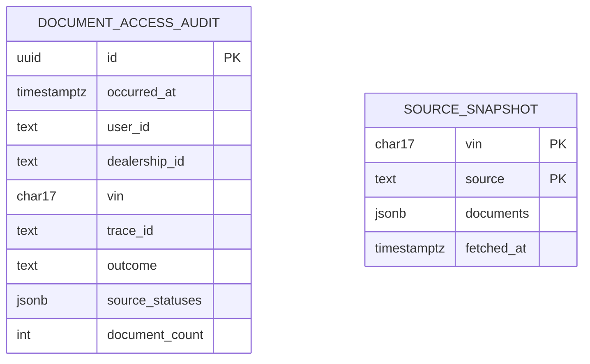

# 04. Data model

Covers tasks **T10** (audit) and **T11** (snapshots). The source systems stay the systems of record for documents. Our database stores only what this service owns:

| Table | Why it exists | Requirement |
|---|---|---|
| `document_access_audit` | Who viewed which vehicle's documents, when, and with what result | NFR3, A10 |
| `source_snapshot` | The last good result per VIN and source, served only when a live call fails | NFR2, A8 |

The two tables are independent, with no foreign keys between them.



## Migration `V1__init.sql`

```sql
-- Who viewed which vehicle's documents. Insert-only.
CREATE TABLE document_access_audit (
    id              UUID         PRIMARY KEY,
    occurred_at     TIMESTAMPTZ  NOT NULL,
    user_id         TEXT         NOT NULL,
    dealership_id   TEXT         NOT NULL,
    vin             CHAR(17)     NOT NULL,
    trace_id        TEXT         NOT NULL,
    outcome         TEXT         NOT NULL CHECK (outcome IN ('COMPLETE', 'PARTIAL', 'FAILED')),
    source_statuses JSONB        NOT NULL,  -- e.g. {"SALES": "OK", "SERVICE": "STALE"}
    document_count  INTEGER      NOT NULL
);
CREATE INDEX idx_audit_vin_time  ON document_access_audit (vin, occurred_at DESC);
CREATE INDEX idx_audit_user_time ON document_access_audit (user_id, occurred_at DESC);

-- Last good result per VIN and source.
CREATE TABLE source_snapshot (
    vin         CHAR(17)     NOT NULL,
    source      TEXT         NOT NULL,
    documents   JSONB        NOT NULL,      -- list of Document, see 05-domain-model.md
    fetched_at  TIMESTAMPTZ  NOT NULL,
    PRIMARY KEY (vin, source)
);
CREATE INDEX idx_snapshot_fetched_at ON source_snapshot (fetched_at);
```

`trace_id` is also the request ID returned in `X-Request-Id` (design doc §6.2), so a support ticket leads from the response to the audit row and the trace.

## Queries

**Save audit (T10):** a plain `INSERT`, run synchronously before the response is sent. If it fails, the service returns 503 with no documents (design doc §4.2 row 7).

**Save snapshot (T11):** an upsert, run in the background after a successful source call. When two requests for the same VIN finish in either order, the database keeps the newer copy, so no locking code is needed:

```sql
INSERT INTO source_snapshot (vin, source, documents, fetched_at)
VALUES (:vin, :source, CAST(:documents AS jsonb), :fetchedAt)
ON CONFLICT (vin, source) DO UPDATE
    SET documents = EXCLUDED.documents,
        fetched_at = EXCLUDED.fetched_at
    WHERE source_snapshot.fetched_at < EXCLUDED.fetched_at;
```

**Read snapshot (T11):** only when a live call fails.

```sql
SELECT documents, fetched_at FROM source_snapshot
WHERE vin = :vin AND source = :source AND fetched_at > :cutoff;
```

`:cutoff` is `clock.instant()` minus `docviewer.fallback-max-age` (24 h), computed in Java rather than with SQL's `now()`, so tests control the time.

## Retention

| Data | Kept for | How |
|---|---|---|
| Snapshots | 24 hours | `SnapshotCleanupJob` runs hourly: `DELETE FROM source_snapshot WHERE fetched_at < :cutoff` |
| Audit rows | Not purged in v1 | The real retention period is a business and legal decision. A purge job can be added later (out of scope) |

## Not stored

- Document files or full document lists outside the 24 h snapshot. The sources own them.
- Anything about the caller beyond the IDs from the gateway headers (A1).

## Tests

| Test | Proves |
|---|---|
| `AuditRepositoryIT.savesOneRowPerSearch` | The columns and JSONB statuses are written as expected |
| `SnapshotRepositoryIT.newerCopyWins` | An older save can't overwrite a newer one |
| `SnapshotRepositoryIT.ignoresCopiesOlderThan24h` | The fallback age limit |
| `SnapshotCleanupJobIT.deletesExpiredSnapshots` | Retention |

All of them use Testcontainers PostgreSQL with Flyway applied, never H2.
