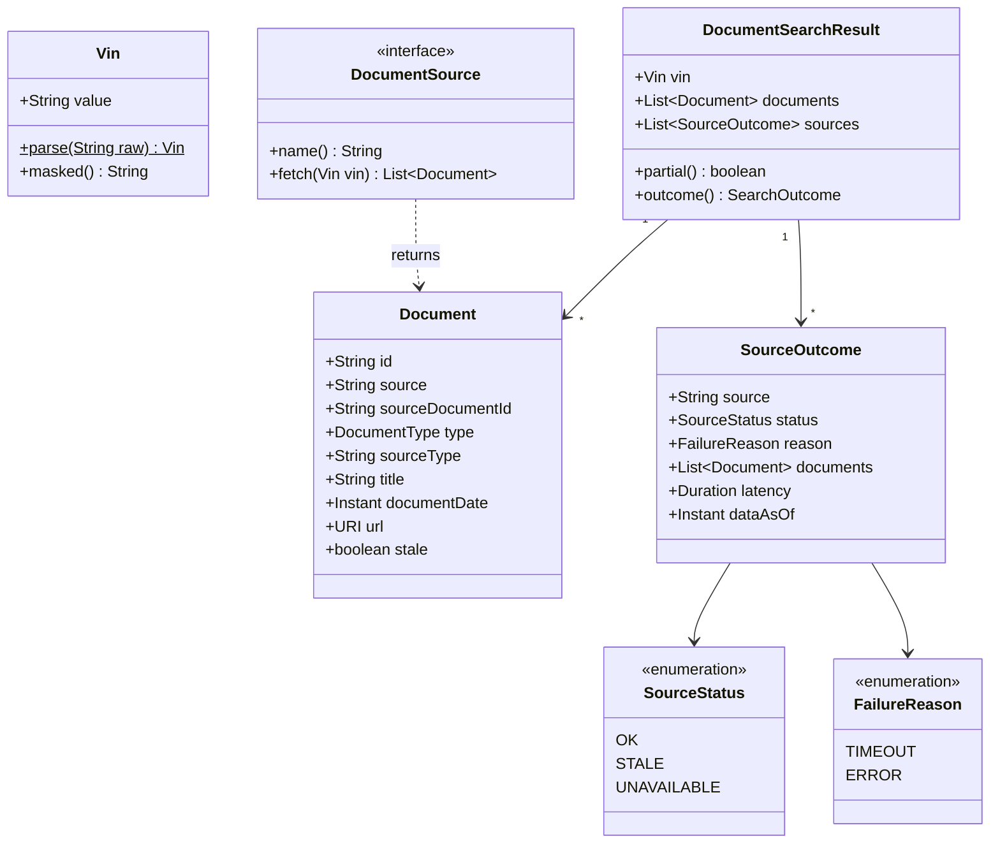

# 05. Domain model

Plain Java records and enums in `search/model/`, plus one interface, `DocumentSource`, in `source/`. They have no framework annotations, so they're tested with fast unit tests. Covers tasks **T05**, **T06** and **T09**.

## Class diagram



## Objects

| Object | Kind | Fields / values | Notes |
|---|---|---|---|
| `Vin` | record | `value` | `Vin.parse(raw)` strips whitespace, checks for 17 ASCII characters from `[A-HJ-NPR-Z0-9]` in either case (no I, O or Q), then upper-cases. Otherwise it throws `InvalidVinException`. `masked()` returns `WVW**********0001`: the first 3 and last 4 characters (A2, A10) |
| `DocumentType` | enum | `ORDER_FORM`, `SALES_INVOICE`, `FINANCE_AGREEMENT`, `PART_EXCHANGE`, `REGISTRATION_DOCUMENT`, `WARRANTY`, `JOB_CARD`, `SERVICE_INVOICE`, `VEHICLE_HEALTH_CHECK`, `MOT_CERTIFICATE`, `SERVICE_HISTORY`, `OTHER` | Unknown source codes map to `OTHER`. The raw code is kept in `sourceType` |
| `Document` | record | `id`, `source`, `sourceDocumentId`, `type`, `sourceType`, `title`, `documentDate` (UTC `Instant`, nullable), `url`, `stale` | The common document format that every adapter produces. `id = source + ":" + sourceDocumentId` |
| `SourceResult` | sealed interface | `Success(source, documents, latency)` and `Failure(source, reason, latency)` | The raw result of one live call. A call always ends in one of these, never an exception |
| `SourceOutcome` | record | `source`, `status`, `reason`, `documents`, `latency`, `dataAsOf` | A `SourceResult` after the fallback has been applied. This is what the API reports per source |
| `SourceStatus` | enum | `OK`, `STALE`, `UNAVAILABLE` | `STALE` means the fallback copy was used |
| `FailureReason` | enum | `TIMEOUT`, `ERROR` | `TIMEOUT` is a connect or read timeout in the adapter, or the service's 2 s deadline. `ERROR` covers refused connections, 5xx after the retry, and unreadable data |
| `SourceException` | runtime exception | `reason` (`FailureReason`) | Thrown by an adapter's `fetch`. The service turns it into `Failure(source, reason, latency)` |
| `DocumentSearchResult` | record | `vin`, `documents`, `sources` | `partial()` and `outcome()` are derived from the fields, never stored |
| `SearchOutcome` | enum | `COMPLETE`, `PARTIAL`, `FAILED` | Written to the audit row and mapped to the HTTP status |
| `Caller` | record | `userId`, `dealershipId` | From the gateway headers (A1) |
| `AccessAuditRecord` | record | `id`, `occurredAt`, `caller`, `vin`, `traceId`, `outcome`, `sourceStatuses`, `documentCount` | One row in `document_access_audit` |
| `Snapshot` | record | `vin`, `source`, `documents`, `fetchedAt` | One row in `source_snapshot` |

## The one interface

```java
public interface DocumentSource {
    String name();                       // "SALES", "SERVICE": each adapter owns its name
    List<Document> fetch(Vin vin);       // throws SourceException(TIMEOUT or ERROR) on any failure
}
```

Spring injects every `DocumentSource` bean into `DocumentSearchService` as a `List<DocumentSource>`. A third source is one new class implementing this interface. No enum, switch or service code changes (NFR5).

## Invariants (each one is a unit test)

1. A `Vin` object is always valid and normalised. Invalid input never gets past `Vin.parse`.
2. `Document.id` is unique in a result. Duplicates are removed within a source only (A6).
3. Documents are sorted newest first. Undated documents come last, and ties are broken by `source`, then `sourceDocumentId`, so the order is always the same (A7).
4. `stale` is `true` only for documents that came from a snapshot.
5. Per source:
   - `OK` has no `reason` and no `dataAsOf`
   - `STALE` has both
   - `UNAVAILABLE` has a `reason` and no documents
6. `partial()` is `true` when any source isn't `OK`.
7. `outcome()` is:
   - `COMPLETE` when all sources are `OK`
   - `FAILED` when no source is `OK` or `STALE`
   - `PARTIAL` in every other case

## Errors → HTTP (design doc §4.2)

| Situation | Raised as | HTTP | Problem `type` |
|---|---|---|---|
| Invalid VIN | `InvalidVinException` from `Vin.parse` | 400 | `invalid-vin` |
| Missing `X-User-Id` or `X-Dealership-Id` | rejected by `CallerFilter` | 401 | `missing-caller` |
| No source is `OK` or `STALE` | `outcome() == FAILED` | 503 | `sources-unavailable`, with `sources[]` |
| Audit can't be saved | `AuditUnavailableException` | 503 | `audit-unavailable`, with no documents |
| Anything unexpected | any other exception | 500 | `internal-error`, no details leaked |

Error bodies use RFC 9457 problem details (`application/problem+json`) and always include the request ID.
