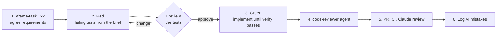

# Implementation plan: Unified Document Viewer

This folder is the plan for Part 2: building the backend described in [`../system-design-document.md`](../system-design-document.md) in **5–7 days**, with Claude Code doing most of the typing and me owning the requirements, the tests and the review.

## What's in this folder

| File | What it covers |
|---|---|
| [`01-project-setup.md`](01-project-setup.md) | Spring Boot project, dependencies, package layout, configuration, Docker Compose and the mock source systems |
| [`02-claude-code-harness.md`](02-claude-code-harness.md) | `CLAUDE.md`, skills, the review agent, hooks, permissions and MCP |
| [`03-ci-pipeline.md`](03-ci-pipeline.md) | GitHub Actions: format check, build and tests, Claude PR review, branch protection |
| [`04-data-model.md`](04-data-model.md) | Database tables, migrations and retention |
| [`05-domain-model.md`](05-domain-model.md) | Java records, enums and the one `DocumentSource` interface |
| [`06-tasks.md`](06-tasks.md) | Every task, with acceptance criteria and the tests to write first |
| [`07-observability.md`](07-observability.md) | Metrics, tracing and logs |
| [`08-cd-aws.md`](08-cd-aws.md) | Optional: Docker image, Terraform and deploying to AWS |
| `briefs/` | Agreed task briefs, written by `/frame-task` (created on first use) |

## The AI-native TDD loop

The rule: **I decide what "done" means, and the tests say it before any code exists.** Claude Code writes both the tests and the code, but it can't move the goalposts.

1. **Frame.** `/frame-task Txx` explains the task in plain words, checks it against the design doc, asks me the open decisions and saves an agreed brief in `briefs/Txx.md`. The brief has Given/When/Then acceptance criteria and the list of tests.
2. **Red.** `/implement-task Txx` first writes only the tests from the brief and runs them to show they fail. It stops for my review. The approved tests are committed as `test(Txx): …`.
3. **Green.** The agent writes the simplest code that makes `./mvnw verify` pass. It may not edit or weaken the tests from the red commit. If it thinks a test is wrong, it stops and asks.
4. **Review.** The `code-reviewer` agent checks the diff against `CLAUDE.md`, the design doc and the red commit. Then the green commit: `feat(Txx): …`.
5. **Ship.** A pull request runs CI. Adding the `claude-review` label gets a second review. I merge.
6. **Log.** Anything the AI got wrong, and how it was caught, goes into `docs/ai-log.md`. That file feeds the README's AI Collaboration Narrative and the video.

The red and green commits make the test-first order visible in the git history.

## Status

| Phase | Tasks | Status |
|---|---|---|
| P0 Foundation | T01–T04 | todo |
| P1 Domain | T05–T06 | todo |
| P2 Source systems | T07–T09 | todo |
| P3 Persistence | T10–T11 | todo |
| P4 API | T12 | todo |
| P5 Observability | T13–T15 | todo |
| P6 Delivery | T16 | todo |
| P7 CD and AWS (optional) | T17–T19 | todo |

## Schedule

| Day | Work | Result at the end of the day |
|---|---|---|
| 1 | T01–T04 (7 h) | Project builds, CI is green on a PR, the harness works, both mocks run in Docker Compose |
| 2 | T05–T07 (6 h) | VIN rules, merging and the Sales adapter, all tested |
| 3 | T08–T09 (6 h) | Both adapters called in parallel with time limits and a retry |
| 4 | T10–T11 (6 h) | Audit (fails closed) and the fallback copy |
| 5 | T12–T13 (5 h) | The REST endpoint, so **the brief's acceptance criteria are met**, plus metrics and the dashboard |
| 6 | T14–T15, start T16 (6 h) | Traces and logs, then the README |
| 7 | Finish T16, record the video (6 h) | README, cURL examples, AI narrative, demo script and the video (about 2 h) |

The core work is about 38 h plus the video, which fills 7 days. **P7 (CD and AWS) only happens if a day is spare.** If time runs short, cut from the bottom: the dashboard in T13 first, then T15. P0–P4 and T16 are the minimum submission.

## Requirement → task traceability

| Requirement (design doc §0) | Tasks |
|---|---|
| FR1 Unified search by VIN | T05, T12 |
| FR2 Parallel calls to both sources | T07, T08, T09 |
| FR3 One list, source shown on each document | T06, T12 |
| NFR1 Performance (< 1 s, ≤ about 2.5 s) | T09, T13 |
| NFR2 Reliability (99.9%, partial results) | T09, T11 |
| NFR3 Security and compliance (audit, masking) | T10, T15 |
| NFR4 Scalability (stateless) | T01, T17–T19 |
| NFR5 Maintainability (new source = one adapter) | T07, T08 |
| NFR6 Observability (alert → source) | T13, T14, T15 |

## Definition of Done (every task)

- [ ] Every acceptance criterion in the brief has a passing test
- [ ] The tests from the red commit are unchanged, or changed only with my agreement and noted in the brief
- [ ] `./mvnw spotless:check verify` passes locally and in CI
- [ ] `code-reviewer` found no blocking issue
- [ ] The task is ticked in [`06-tasks.md`](06-tasks.md), and its phase status here is updated
- [ ] Any AI mistake is logged in `docs/ai-log.md`
