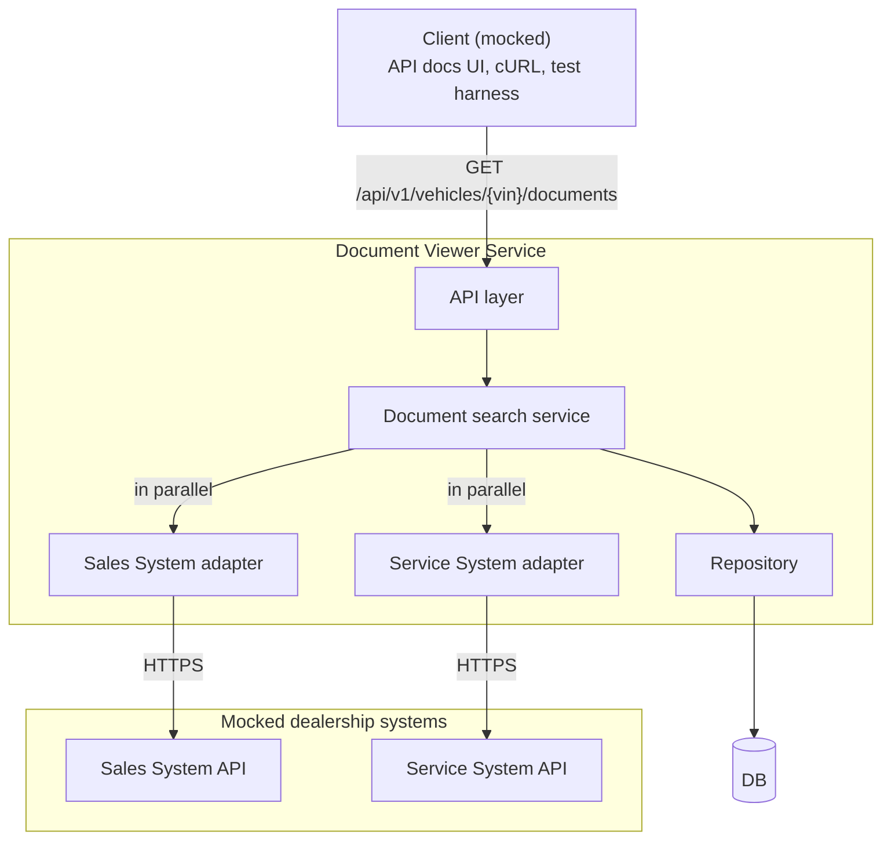
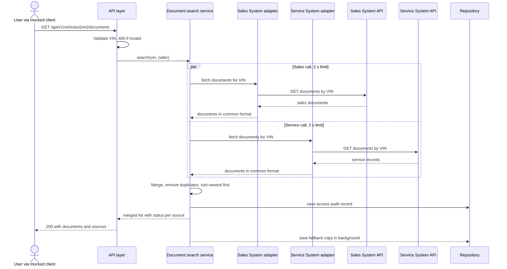
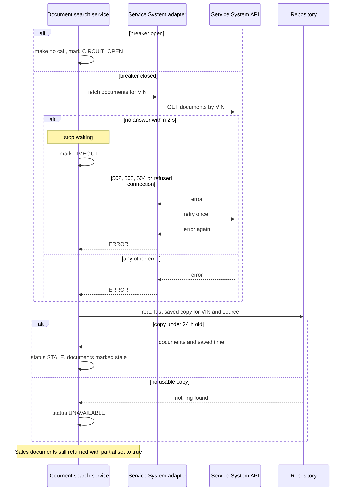

# System Design Document: Unified Document Viewer

## Table of contents

0. [Requirements clarification](#0-requirements-clarification)
1. [Assumptions](#1-assumptions)
2. [Architecture diagram](#2-architecture-diagram)
3. [Components](#3-components)
4. [Data flow](#4-data-flow)
   - 4.1 [Normal path](#41-normal-path)
   - 4.2 [Failure paths](#42-failure-paths)
5. [Technologies](#5-technologies)
6. [Observability strategy](#6-observability-strategy)
   - 6.1 [Strategy](#61-strategy)
   - 6.2 [Implementation](#62-implementation)
7. [How I used GenAI in the design phase](#7-how-i-used-genai-in-the-design-phase)

---

## 0. Requirements clarification

**Scenario:** D, Unified Document Viewer (Domain: Operate) · **Layer built:** Backend · **Author:** Hien Giang · **Date:** 2026-10-29

**Goal.** A dealership user enters a VIN and sees one consolidated list of every document for that vehicle, with the source system shown for each document.

**Functional requirements** (from the brief)

| # | Requirement |
|---|---|
| FR1 | **Unified search:** the user enters a VIN in a single search |
| FR2 | **Data aggregation:** the backend calls the Sales System API and the Service System API (both mocked) in parallel |
| FR3 | **Aggregated view:** one consolidated list of documents from both sources, each labelled with its source system |

**Non-functional requirements** (how I read "Build for the Future")

| # | Quality | Target |
|---|---|---|
| NFR1 | Performance | Most requests answer in under 1 s. A slow source can't make the user wait more than about 2.5 s |
| NFR2 | Reliability | 99.9% of requests succeed (partial results count as success). A slow or failing source never hides the other source's documents |
| NFR3 | Security and compliance | Every access to a vehicle's documents is audited. No document content or full VINs in logs, metrics or traces |
| NFR4 | Scalability | Stateless service that scales by adding instances |
| NFR5 | Maintainability | Adding a third source means adding one adapter |
| NFR6 | Observability | An alert leads quickly to the source that caused the problem |

**Out of scope.**
- The UI (backend scenario, so the client is mocked)
- Opening or downloading the document files (we return links)
- Search by anything other than the full VIN
- Real login (caller identity is stubbed)

**Proposed solution in one sentence.** A stateless service calls one adapter per source system in parallel, gives each call a strict time limit, and merges the results into one document list. If a source fails, it returns the documents it has, with a status for each source, instead of failing the whole request.

Other open points are covered as assumptions in §1.

---

## 1. Assumptions

The brief leaves these points open, so I made the following assumptions.

| # | Assumption |
|---|---|
| A1 | Users are signed-in dealership staff. An upstream gateway passes `X-User-Id` and `X-Dealership-Id`, and this service trusts them (stubbed) |
| A2 | Search uses the full VIN only: 17 characters, no I, O or Q (ISO 3779), trimmed and upper-cased. The check digit isn't enforced, because only North America requires it |
| A3 | Each source offers a REST/JSON lookup by VIN that returns document **metadata plus a link** to the file, not the file itself |
| A4 | The two source APIs return **different shapes** (field names, nesting, date formats, type codes). Their contracts are mine, because they are mocked |
| A6 | A VIN has tens of documents, so there's no pagination in v1. Each document belongs to exactly one system, so duplicates are only removed within a source |
| A7 | The list is sorted newest first, with undated documents last. All times are in UTC |
| A8 | Users expect live data. A copy up to 24 h old is acceptable **only as a labelled fallback** when a source fails |
| A9 | A healthy source answers in under about 500 ms |
| A10 | VINs and document metadata can be personal data (GDPR), so every access is audited and VINs are masked in logs |
| A11 | The client is mocked with an OpenAPI spec, Swagger UI, cURL examples and an automated test harness |

---

## 2. Architecture diagram



---

## 3. Components

| Component | Role |
|---|---|
| **Client (mocked)** | API docs UI, cURL examples and a test harness stand in for the UI |
| **API layer** | Exposes the endpoint, validates the VIN and caller identity, returns HTTP status and JSON |
| **Document search service** | Calls both adapters in parallel, applies the fallback, merges the results and records the audit |
| **Sales System adapter** | Calls the Sales System API resiliently and maps its response to the common document format |
| **Service System adapter** | Same for the Service System API. A new source is just one more adapter |
| **Repository** | Saves the access audit log and the 24 h fallback snapshots |
| **DB** | Stores the audit log and snapshots. The sources stay the systems of record |
| **Sales System API / Service System API (mocked)** | Mock APIs with different response shapes that can inject delays and errors |

---

## 4. Data flow

### 4.1 Normal path



1. **Request.** The user sends a VIN. The caller's identity comes with it.
2. **Validate.** An invalid VIN gets 400, and no system is called.
3. **Ask both systems at once.** Each system has 2 s to answer. The user waits only as long as the slower one, not both added together.
4. **Translate.** Each adapter converts its system's format into one common document format.
5. **Fallback.** If a system fails, is too slow, or its circuit breaker is open, the service uses its last saved copy if it's under 24 h old, and marks it `STALE`. Otherwise the source is marked `UNAVAILABLE`.
6. **Merge.** The documents are combined, duplicates removed, sorted newest first, and each one is labelled with its source.
7. **Audit and respond.** The service records who viewed which vehicle's documents, then responds. If the audit can't be saved, it returns 503 and no documents, because documents carry personal data.
8. **Save a copy.** Each successful result is saved in the background as the next fallback copy.

### 4.2 Failure paths

What happens when one source (here the Service System) fails. The Sales call runs in parallel and isn't affected.



| # | Failure | What the service does | Result to the client |
|---|---|---|---|
| 1 | Invalid VIN | Rejects it before calling any system | **400** |
| 2 | Missing caller identity | Rejects the request | **401** |
| 3 | Source too slow (no answer in 2 s) | Stops waiting and uses the fallback copy | **200**, `partial: true`, reason `TIMEOUT` |
| 4 | Source returns an error or can't be reached | Retries once on 502, 503, 504 or a refused connection, because those are often short-lived. Any other error isn't retried. Then uses the fallback copy | **200**, `partial: true`, reason `ERROR` |
| 5 | Source returns data that can't be read | Treats an unreadable response as an error. A single bad item is dropped and the response stays complete | **200**, `partial: true` if the whole response was unreadable |
| 6 | Both sources fail, no fallback copy | Records the failed access | **503**, with each source's status |
| 7 | Audit can't be saved | Returns no documents, because an unrecorded access isn't allowed | **503** |
| 8 | Saving the fallback copy fails | Logs it. The user already has the response | User not affected |
| 9 | Source keeps failing, so its circuit breaker is open | Makes no call and uses the fallback copy | **200**, `partial: true`, reason `CIRCUIT_OPEN`. **503** only if no source has anything to return (row 6) |

When a source fails, or its circuit breaker is open, its status is `STALE` if a fallback copy under 24 h old exists, and `UNAVAILABLE` if not. The response is 200 whenever at least one source is `OK` or `STALE`.


---

## 5. Technologies

| Group | Technology | Why |
|---|---|---|
| **Language and framework** | Java 21 | Virtual threads make parallel blocking calls cheap and keep the code simple to read and test. It's my strongest language |
| | Spring Boot 4 | `RestClient`, `JdbcClient`, Actuator, and Micrometer metrics and tracing built in |
| **Resilience** | Spring Framework retry (`@Retryable`) | One retry per source, built into Spring Framework 7 |
| | resilience4j-circuitbreaker (core library only) | One breaker per source. Spring Framework 7 has no breaker |
| **Data** | PostgreSQL 16 | Reliable and transactional for the audit log. JSONB stores the snapshots. Available as Amazon RDS |
| | Flyway | Versioned, reviewable schema migrations |
| **API contract** | springdoc-openapi | Generates the OpenAPI spec and Swagger UI from the code, so the mocked client always matches the API |
| **Testing** | WireMock | Mocks both source APIs with different shapes, and injects delays and errors for tests and the demo |
| | JUnit 5, Testcontainers | Tests against real PostgreSQL and real HTTP mocks |
| **Observability** | Micrometer, Prometheus, Grafana | Metrics and dashboards |
| | OpenTelemetry, Jaeger | Vendor-neutral tracing. Jaeger locally, AWS X-Ray in production |
| **Local runtime** | Docker Compose | One command runs the whole system locally |
| **CI/CD and infrastructure** | GitHub Actions | CI/CD workflows that build and test every change. The AI agent harness uses them as its feedback loop during implementation |
| | Terraform (optional) | Infrastructure as code for the CD pipeline, used to provision a walking skeleton on AWS repeatably |
| | AWS (optional) | Deployment target for the walking skeleton: ECS Fargate, RDS PostgreSQL, Secrets Manager |

---

## 6. Observability strategy

### 6.1 Strategy

The main risk is the two source systems we don't control. So we watch the service **the way users experience it**, and we watch **each source system separately**, so we can quickly see which one is causing a problem.

| What we use | What it tells us |
|---|---|
| **Metrics** | Is the service fast and working? Is each source system healthy? How often do users get partial results? |
| **Traces** | For one request, which source call was slow or failed |
| **Logs** | What happened in a request, with a request ID that links to its trace |

**Alerts.**
- **Urgent:** the latency or availability targets (NFR1, NFR2) are being missed, or the audit log can't be saved.
- **Warning:** one source system is failing or slow for more than 5 minutes, because the fallback copy is covering for it.

**Finding the cause.** Alert → dashboard → trace of a failing request → its logs.

### 6.2 Implementation

**Metrics.**

| Metric | Type | Labels | What it shows |
|---|---|---|---|
| `docviewer_requests_total` | Counter | `outcome` (complete, partial, failed), `status` | Availability and how often results are partial |
| `docviewer_request_duration_seconds` | Histogram | — | Latency against the 1 s target |
| `docviewer_source_calls_total` | Counter | `source`, `result` (ok, timeout, error) | Health of each source system |
| `docviewer_source_duration_seconds` | Histogram | `source` | Which source is slow |
| `docviewer_fallback_served_total` | Counter | `source` | How often users see stale data |
| `docviewer_audit_failures_total` | Counter | — | Compliance risk. Triggers the urgent alert |

The alerts in 6.1 are rules on these metrics. The dashboard has one panel per source system.

**Tracing.**
- One trace per request, started at the API layer. The trace ID is also the request ID and is returned in the `X-Request-Id` header, so a support ticket leads straight to the trace.
- Each step of the request is a span:

```text
GET /api/v1/vehicles/{vin}/documents   whole request
├── sales.fetch      Sales System adapter → Sales System API      ┐ run in
├── service.fetch    Service System adapter → Service System API  ┘ parallel
├── fallback.read    only when a source failed
└── audit.save
```

- Each span records `source`, `result`, `document_count` and the masked VIN.
- The trace context is passed to the parallel tasks and to the source systems in the W3C `traceparent` header, so their traces join ours.
- Sampling: every failed or slow trace is kept, plus about 10% of normal ones.

**Logs.** JSON, one line per event. Each request writes one summary line at `INFO`. Adapter failures are logged at `WARN`. Example summary line:

```json
{
  "timestamp": "2026-10-29T09:15:02.481Z",
  "level": "INFO",
  "message": "documents.search completed",
  "traceId": "4f6c2a7e9b1d4a538f0e2d7c1e5b9a10",
  "spanId": "8f0e2d7c1e5b9a10",
  "userId": "u-1024",
  "dealershipId": "d-077",
  "vin": "WVW**********0001",
  "httpStatus": 200,
  "outcome": "PARTIAL",
  "durationMs": 2012,
  "sources": [
    { "source": "SALES", "status": "OK", "latencyMs": 182, "documentCount": 1 },
    { "source": "SERVICE", "status": "STALE", "reason": "TIMEOUT", "latencyMs": 2000, "documentCount": 1 }
  ]
}
```

Document titles, URLs, tokens and full VINs are never logged. The masked VIN keeps the first 3 characters (the manufacturer code) and the last 4.

---

## 7. How I used GenAI in the design phase

I used **Claude Code** (Claude Opus 5.5) in **plan mode**, so nothing is written until I approve the AI's plan.

| Action | Why |
|---|---|
| Let Claude Code read the challenge | Give the agent the full brief as context |
| Told Claude Code to analyze the 4 challenges | Choose a scenario that best fits my background. I chose D because I have production experience in a platform that demands resilience design |
| Asked Claude Code to research Keyloop's products | Build a mental model about the products, use them as my understanding to verify the agent's output in the implementation phase |
| Made the key decisions myself when the AI asked: the stack, what the database stores, and the scope | Keep ownership of the design. I chose Java 21 + Spring Boot 4 (the current release at scaffold time), my strongest stack |
| Had the AI draft a detailed design, then directed it to simplify: generic components, a simpler data flow, a shorter observability section | Opus 5.5's first draft (xhigh effort) was over-engineered for Part 1. Keep the document at the design level, remove implementation details |
| Reviewed every AI draft against the brief and pushed back: removed framework names from the diagrams, cut circuit breaker and bulkhead from the data flow, rewrote observability from a metrics list into a strategy | AI output is a draft. I own what gets submitted. (A per-source breaker was added later, in T12b: see [ADR 0001](adr/0001-circuit-breaker-per-source.md).) |
| Turned common AI coding mistakes into planned tests: calling the sources one after the other, one failure failing the whole request, missing timeouts | Catch these mistakes with failing tests in Part 2, not by luck in review |
